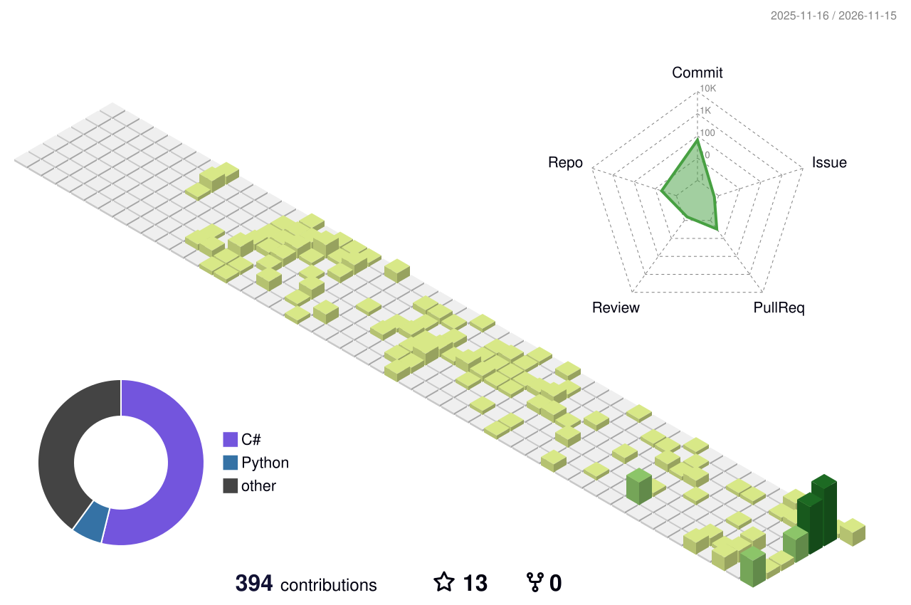

 

  
  
  
  
  

---

### 🚀 Featured Project

**[T-Drive](https://apps.microsoft.com/store/detail/tdrive/9MVD1PKDTXSN)** — Free, secure, unlimited cloud file storage based on Telegram  
⚡ *Currently working on **[T-Drive v3.0](https://t.me/tdrivecommunity)***

 

&nbsp;&nbsp;

---

### 📦 Open Source

  
  
   
  
  

---

### 🛠 Tech Stack & Tools

  
  
  

---

### 📊 GitHub Stats & Activity

  
  
   
  
   
  

---

### 🧊 Contributions

<picture>
  <source media="(prefers-color-scheme: dark)" srcset="./profile-3d-contrib/profile-night-green.svg" />
  <source media="(prefers-color-scheme: light)" srcset="./profile-3d-contrib/profile-green-animate.svg" />
  
</picture>

 

<picture>
  <source media="(prefers-color-scheme: dark)" srcset="./dist/github-contribution-grid-snake-dark.svg" />
  <source media="(prefers-color-scheme: light)" srcset="./dist/github-contribution-grid-snake.svg" />
  
</picture>

---

### ☕ Support

  

